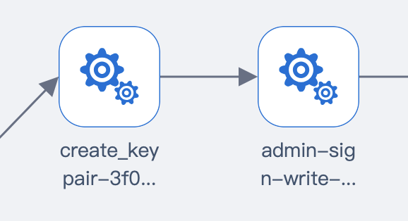
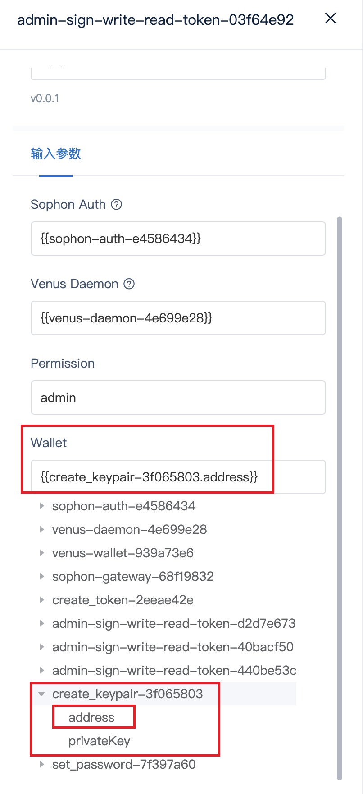

# 插件开发指南

## 1. 开发流程概述

1. 准备工作
   - 参考现有的 venus 插件实现
   - 理解插件模板结构

2. 编写插件代码
   - 按照模板填写自定义内容
   - 遵循单一职责原则
   - 实现插件间参数传递

3. 编译与测试
   - 使用正确的编译命令
   - 通过页面上传插件
   - 创建 job 验证功能

## 2. 插件开发规范

### 2.1 基本原则

1. 单一职责：每个插件专注于一个功能
2. 最小化原则：功能实现尽量精简
3. 模板规范：仅修改必要的自定义内容

### 2.2 插件模板结构

```go
package main

import (
    "context"
    "github.com/ipfs-force-community/brightbird/pkg/env"
    "github.com/ipfs-force-community/brightbird/pkg/env/plugin"
    "github.com/ipfs-force-community/brightbird/pkg/types"
    "github.com/ipfs-force-community/brightbird/pkg/version"
)

func main() {
    plugin.SetupPluginFromStdin(Info, Exec)
}

// 插件基本信息
var Info = types.PluginInfo{
    Name:        "{{plugin_name}}",        // 插件名称
    Version:     version.Version(),        // 插件版本
    PluginType:  types.TestExec,          // 插件类型
    Description: "{{plugin_description}}", // 插件描述
}

// 渲染参数定义
type RenderParams struct {
    Config
    NameSpace       string   
    PrivateRegistry string   
    Args            []string 
    UniqueId       string   
}

// 执行参数定义
type TestCaseParams struct {
    // 自定义参数
}

// 执行逻辑
func Exec(ctx context.Context, k8sEnv *env.K8sEnvDeployer, params TestCaseParams) error {
    // 实现插件逻辑
    return nil
}
```

## 3. 参数传递指南

### 3.1 输出参数定义

```go
// 定义输出结构
type CreateKeyPair struct {
    Address    address.Address `json:"address" jsonschema:"address" title:"Address" require:"true" description:"address created"`
    PrivateKey string         `json:"privateKey" jsonschema:"privateKey" title:"Private Key" require:"true" description:"private key created"`
}

func Exec(ctx context.Context, k8sEnv *env.K8sEnvDeployer, params TestCaseParams) (*CreateKeyPair, error) {
    // ...执行逻辑...
    return &CreateKeyPair{
        Address:    walletAddr,
        PrivateKey: hex.EncodeToString(kiBytes),
    }, nil
}
```

### 3.2 输入参数定义

```go
type TestCaseParams struct {
    Wallet address.Address `json:"wallet" jsonschema:"wallet" title:"Wallet" require:"true" description:"wallet address"`
}

func Exec(ctx context.Context, k8sEnv *env.K8sEnvDeployer, params TestCaseParams) error {
    // 使用 params.Wallet
    return nil
}
```

### 3.3 全局变量使用

```go
type DepParams struct {
    venus.Config
    Global env.GlobalParams                  `jsonschema:"-" json:"global"`
    Auth   sophonauth.SophonAuthDeployReturn `json:"SophonAuth" jsonschema:"SophonAuth" title:"Sophon Auth" require:"true" description:"sophon auth return"`
}

func Exec(ctx context.Context, k8sEnv *env.K8sEnvDeployer, depParams DepParams) (*venus.VenusDeployReturn, error) {
    var bootstrapPeers []string
    err := depParams.Global.GetProperty("BootstrapPeer", &bootstrapPeers)
    if err != nil {
        return nil, err
    }
    // 使用获取的全局变量
    // ...其他代码...
}
```

## 4. 常见问题

### 4.1 命名规范

Q: TestCaseParams 结构中的输入参数必须以大写字母开头吗？
A: 是的，必须使用大写字母开头，例如：

```go
type TestCaseParams struct {
    Auth    sophonauth.SophonAuthDeployReturn `json:"SophonAuth" jsonschema:"SophonAuth" title:"Sophon Auth" require:"true" description:"sophon auth return"`
}
```

### 4.2 Pod 命令执行

Q: 如何在 pod 中执行命令？
A: 使用 ExecRemoteCmd 方法：

```go
pods, err := dropletmarket.GetPods(ctx, k8sEnv, params.Droplet.InstanceName)
if err != nil {
    return err
}

_, err = k8sEnv.ExecRemoteCmd(ctx, pods[0].GetName(), cmd)
if err != nil {
    return err
}
```

## 5. 配置示例

### 5.1 参数连接配置

<div align="center">
  
</div>

插件间参数传递配置步骤：

1. 在源插件(如 create_keypair)中定义输出参数
2. 在目标插件(如 admin)中定义匹配的输入参数
3. 在页面上选择对应的参数进行连接

### 5.2 参数选择界面

<div align="center">
  
</div>

> 注意：输入输出参数类型必须严格匹配。例如，如果需要 address.Address 类型，就必须选择对应类型的输出参数。
