<!-- 

  

 -->

<h1 align="center">Brightbird 用户手册</h1>

  
  
  
  
   

Brightbird 测试平台允许用户上传独立的测试插件，并根据插件间的参数传递和依赖关系，灵活编排测试流程。通过 Job 管理触发执行，实现对各类后端程序的自动化测试。

---

## 目录

- [工作流程图](#工作流程图)
- [分组管理](#分组管理)
  - [分组列表](#分组列表)
  - [新建分组](#新建分组)
- [插件管理](#插件管理)
  - [插件列表](#插件列表)
  - [插件上传](#插件上传)
  - [插件详情](#插件详情)
- [测试流管理](#测试流管理)
  - [测试流编辑](#测试流编辑)
  - [插件依赖选择](#插件依赖选择)
  - [保存测试流](#保存测试流)
  - [测试流列表](#测试流列表)
- [Job 管理](#job-管理)
  - [新建 Job](#新建-job)
  - [Job 管理列表](#job-管理列表)
  - [Job 触发列表页](#job-触发列表页)
- [日志查询](#日志查询)
  - [Job 日志概览](#job-日志概览)
  - [日志详情](#日志详情)

---

## 工作流程图

展示了 Brightbird 平台的测试整体工作流程。

  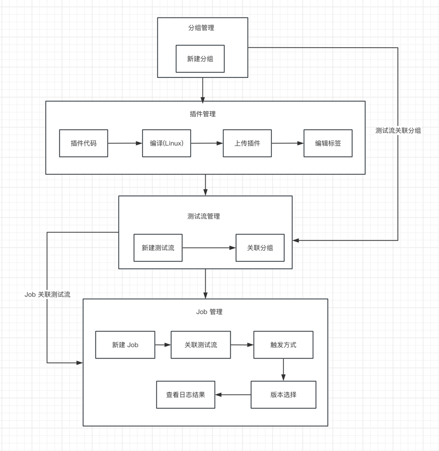

## 分组管理

分组管理用于对测试流进行分类，方便查找和使用。

> 例如新建一个"主网测试流分组", 那么这个分组将专门用于后续的主网测试。

### 分组列表

查看已创建的分组。

  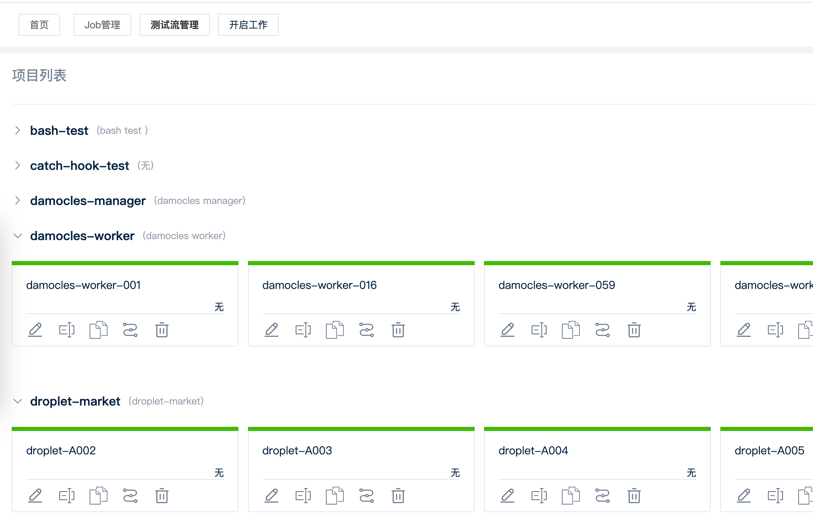

### 新建分组

创建新的测试流分组。

  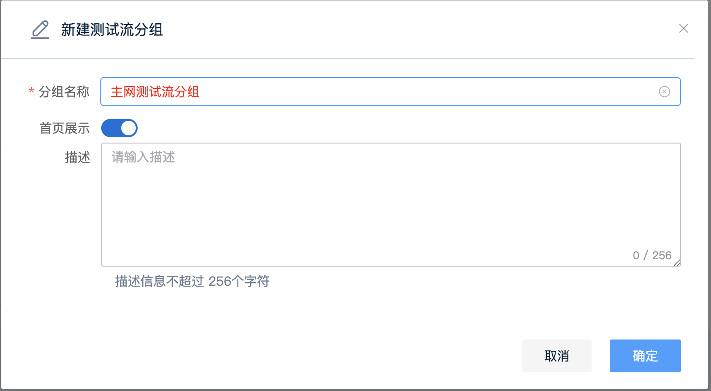

## 插件管理

管理测试平台中使用的部署插件和测试插件。

### 插件列表

> 插件列表分为测试插件和部署插件：
>
> - **部署插件**: 需要被测试的组件或服务。
> - **测试插件**: 用于对部署插件进行测试的逻辑。

  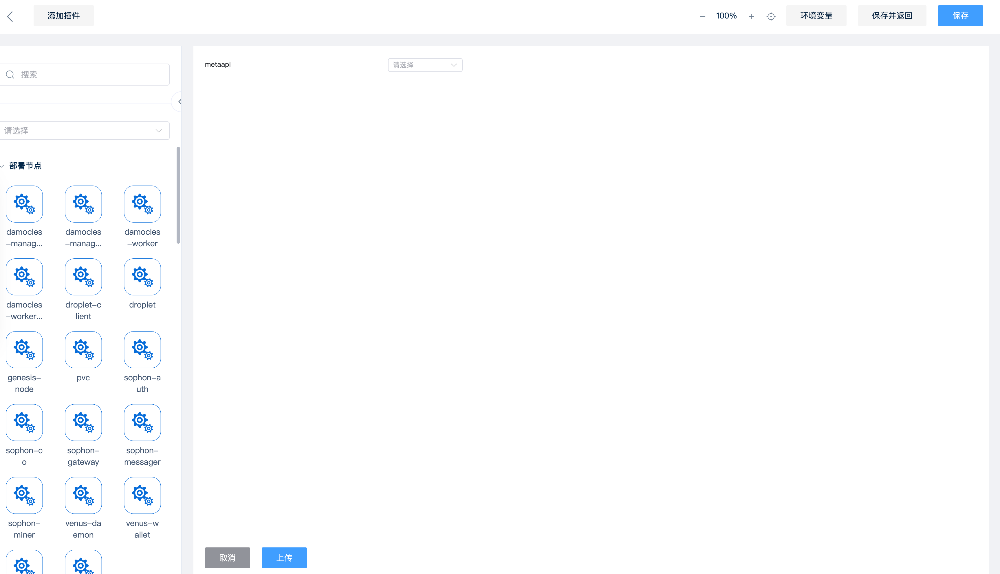

### 插件上传

> - 上传的插件必须是 Linux 系统可执行文件。
> - 对于 Go 语言项目，可以使用 `CGO_ENABLED=0 GOOS=linux GOARCH=amd64 go build main.go` 命令在 macOS 等系统上交叉编译出 Linux 可执行程序。
> - 点击“选择文件”将插件添加到待上传列表，然后点击“上传”完成提交。系统会自动根据插件结构判断其类型（部署或测试）。

### 插件详情

> - 点击插件名称可查看详细信息。
> - **标签功能**: 可以为插件添加或修改标签，便于分类管理。在测试流编辑页面，可以通过搜索标签快速查找所需插件。

  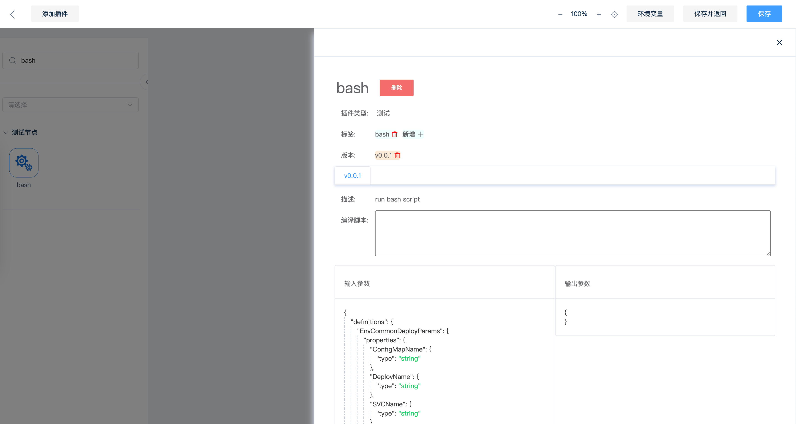

## 测试流管理

通过图形化界面组合插件，编排测试流程。

### 测试流编辑

> - **组合插件**: 通过拖拽和连接插件，构建满足特定测试场景的流程。
> - **搜索**: 支持模糊匹配插件名称或直接搜索标签。
> - **插件连接**: 鼠标移动到插件边缘出现标记点，点击并拖动鼠标连接到另一个插件的标记点，建立依赖关系。
> - **运行顺序**: 连线方向决定了插件的执行顺序（从前置插件指向后置插件）。请确保整体连线逻辑正确。

  

### 插件依赖选择

> - 当插件间存在数据传递时，点击目标插件，配置其输入参数来源。
> - 可以选择依赖插件的整个输出，或点击 `>` 展开选择输出结果中的具体某个值。
> - 系统为每个插件实例分配唯一 UUID。如果同一类型的插件在流程中存在多个实例，通过 UUID 区分并选择正确的依赖来源。

  

### 保存测试流

> 编辑测试流名称，选择所属分组，填写描述信息，然后点击“确定”保存。

  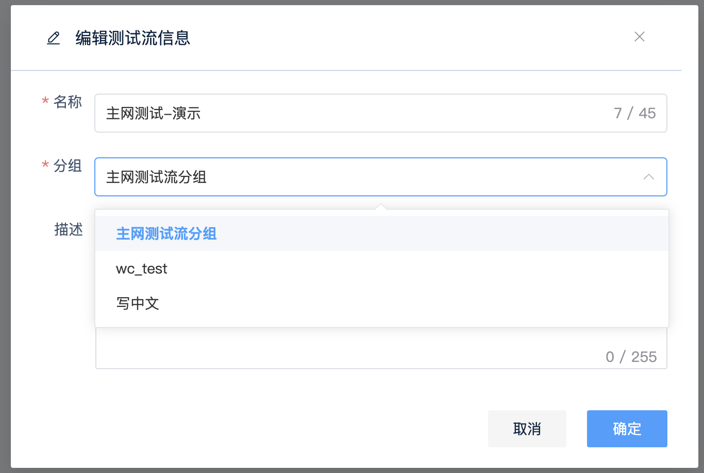

### 测试流列表

> 在此页面可以对已保存的测试流进行修改、查看详情或删除操作。

  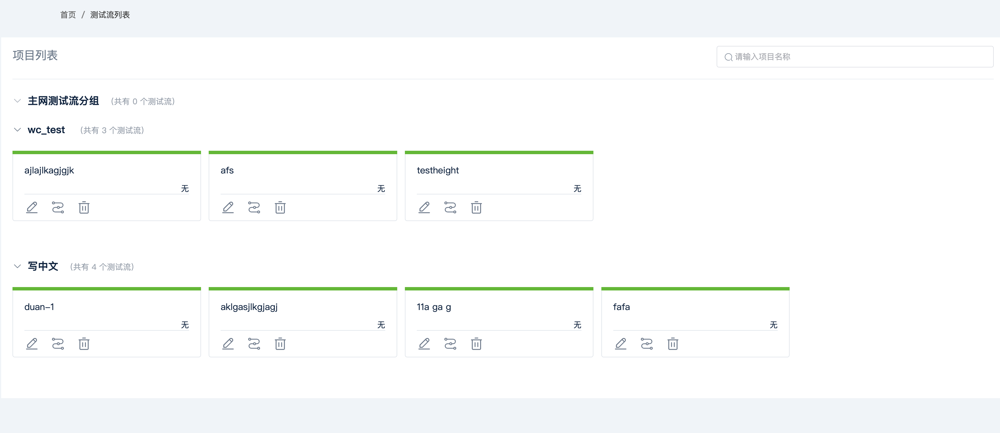

## Job 管理

Job 用于定义如何以及何时触发执行某个测试流。

### 新建 Job

> - 选择要触发的测试流及其所属分组。
> - 选择触发类型：
>   - **cron_job**: 定时任务，使用标准的 cron 表达式（分 时 日 月 星期）。具体用法请查阅 cron 相关资料。
>   - **pr_merged_hook**: 当关联的代码仓库有 Pull Request 合并时触发。
>   - **tag_created_hook**: 当关联的代码仓库创建新 Tag 时触发。

  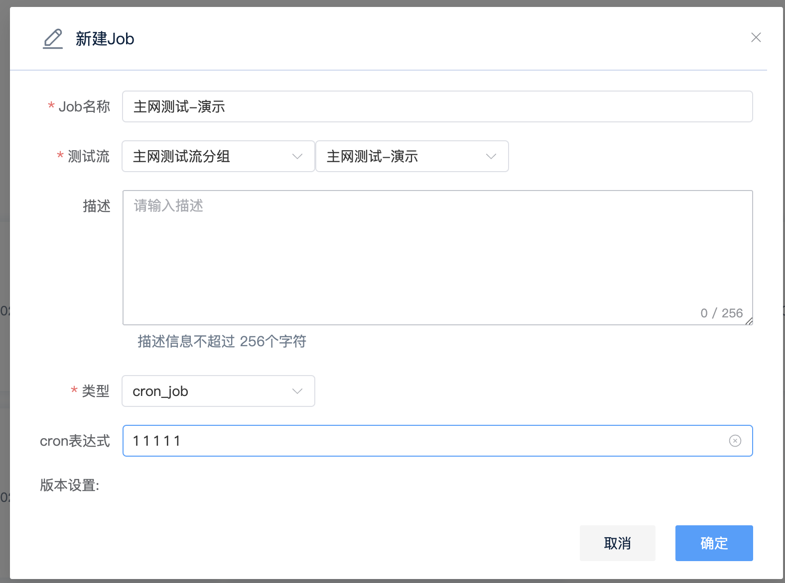

### Job 管理列表

> 此页面列出了所有已创建的 Job，可以进行手动触发、修改或删除操作。

  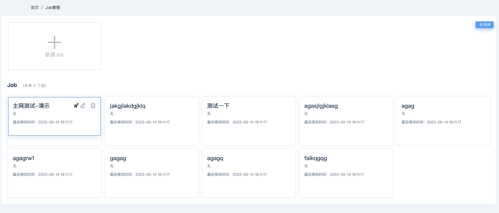

### Job 触发列表页

> 点击 Job 管理列表中的 Job 名称，可以查看该 Job 的所有触发执行记录。

## 日志查询

查看 Job 执行的结果和详细日志。

### Job 日志概览

> - 在 Job 触发列表页，可以查看每次执行的概要信息。
> - 状态指示：
>   - **绿色**: 表示测试通过。
>   - **红色**: 表示测试未通过或执行出错。

  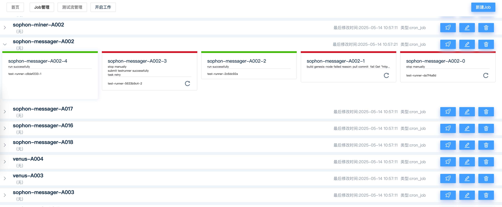

### 日志详情

> - 点击 Job 触发列表中的某次执行记录，进入日志详情页面。
> - 点击各插件名称可展开或折叠其对应的执行日志。
> - 可以使用浏览器的页面内搜索功能（通常是 Ctrl+F 或 Cmd+F）查找关键字。

  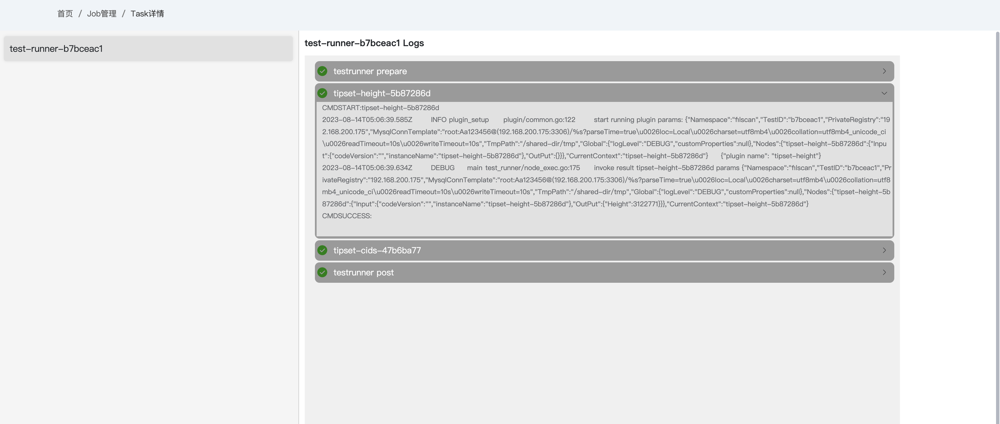

